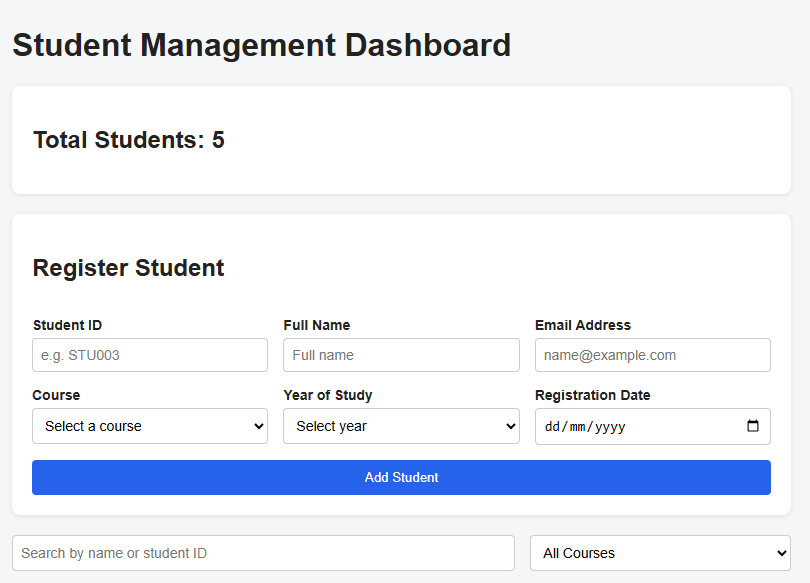
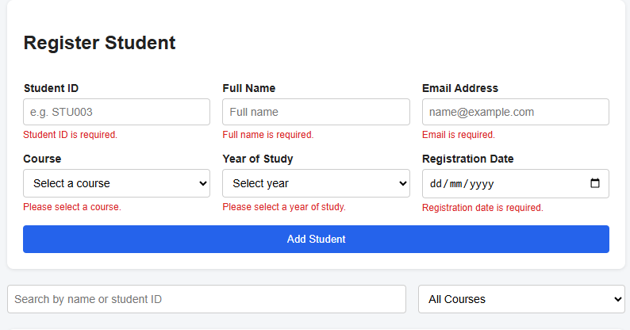
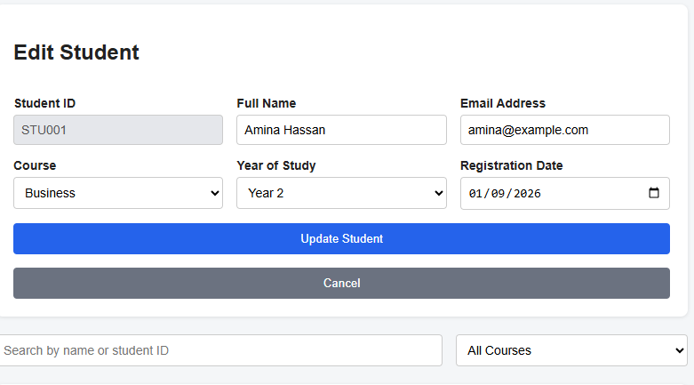
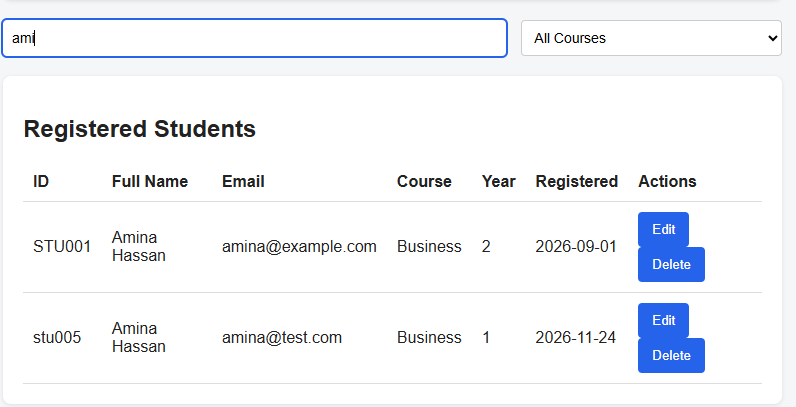
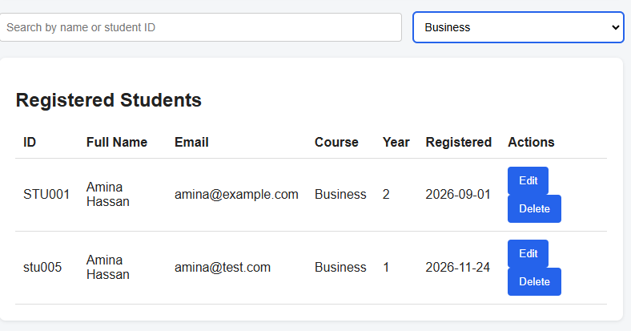
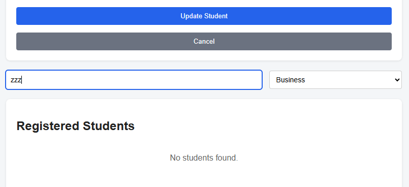
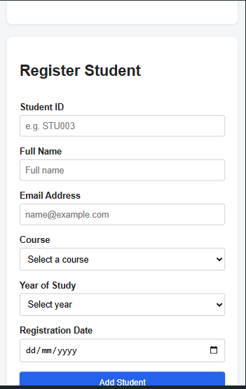

# Student Management Dashboard

A React application that lets a school administrator register, view, search, filter, edit and delete student records. Data is saved in the browser using LocalStorage, so records remain after refreshing the page.

## Technologies Used

- React (functional components and hooks)
- Vite
- JavaScript (ES6)
- CSS
- LocalStorage
- Git and GitHub

## Features

- Register a new student (ID, full name, email, course, year of study, registration date)
- View all students in a table
- Edit an existing student's details
- Delete a student with a confirmation prompt
- Search by name or student ID
- Filter by course
- Total number of registered students
- Records saved in LocalStorage
- Form validation with error messages (required fields, valid email, no duplicate IDs)
- "No students found" message for empty results
- Responsive layout for smaller screens

## Installation

1. Clone the repository:

```bash
git clone https://github.com/wariod1/student-management-dashboard.git
```

2. Go into the project folder:

```bash
cd student-management-dashboard
```

3. Install dependencies:

```bash
npm install
```

4. Start the development server:

```bash
npm run dev
```

5. Open the link shown in the terminal (usually http://localhost:5173).

## Project Structure

```
student-management-dashboard/
|-- public/
|-- screenshots/
|-- src/
|   |-- components/
|   |   |-- Dashboard.jsx
|   |   |-- StudentForm.jsx
|   |   |-- StudentList.jsx
|   |   |-- SearchBar.jsx
|   |   |-- CourseFilter.jsx
|   |-- App.jsx
|   |-- main.jsx
|   |-- index.css
|-- package.json
|-- README.md
```

## Screenshots

### Dashboard


### Form Validation


### Edit Mode


### Search


### Course Filter


### No Students Found


### Mobile View


## How I Implemented the Key Concepts

### React State
I used the `useState` hook to store data that changes over time. The list of students and the student being edited are stored in `App`. The search text and selected course are stored in `Dashboard`. The form values and error messages are stored in `StudentForm`. When a setter function such as `setStudents` is called, React re-renders the screen with the new data.

### Props
Props are used to pass data and functions from parent components to child components. For example, `App` passes the `students` list to `Dashboard`, which passes it on to `StudentList`. Functions such as `addStudent`, `deleteStudent` and `updateStudent` are also passed down as props, so a child component can tell the parent when something should change.

### Search and Filtering
In `Dashboard`, I use the `filter()` method twice. The first keeps students whose name or student ID contains the text typed in the search bar, ignoring capital letters. The second keeps students who match the selected course, or everyone if "All Courses" is selected. The filtered list is passed to `StudentList`, which displays it with `map()`.

### LocalStorage
When the app starts, `useState(loadStudents)` reads the saved students from LocalStorage and converts them from text to a list with `JSON.parse`. If nothing is saved, it uses the default sample students. A `useEffect` with `[students]` as its dependency runs every time the list changes and saves it using `JSON.stringify`. This is why records remain after refreshing the page.
